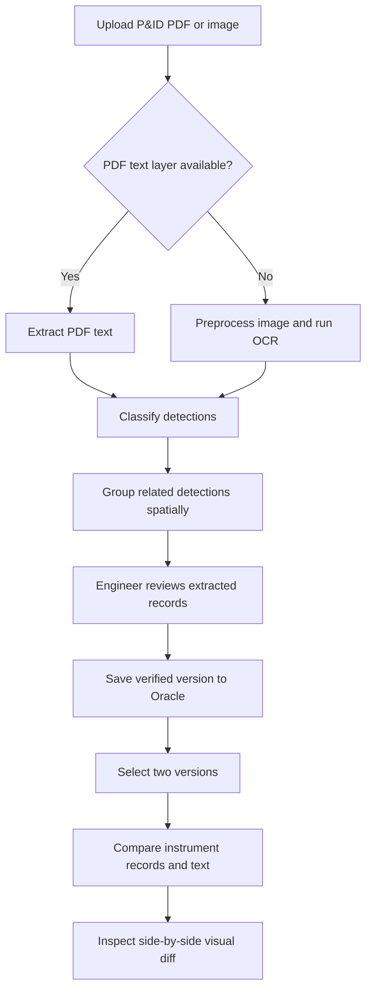

# P&ID Instrument Extractor & Version Diff

A Streamlit application for extracting instrument information from engineering **Piping and Instrumentation Diagram (P&ID)** drawings and comparing drawing revisions.

The application combines PDF text extraction, OCR, rule-based classification, spatial grouping, human verification, Oracle persistence, and visual revision comparison. It is designed to help engineers review drawing changes more efficiently and reduce the amount of repetitive manual work involved in instrument data collection and cost-estimation workflows.

## Contents

- [Overview](#overview)
- [Key Features](#key-features)
- [Workflow](#workflow)
- [Technology Stack](#technology-stack)
- [Project Structure](#project-structure)
- [Getting Started](#getting-started)
- [How Extraction Works](#how-extraction-works)
- [How Revision Comparison Works](#how-revision-comparison-works)
- [Visual Change Legend](#visual-change-legend)
- [Limitations](#limitations)
- [Security Notes](#security-notes)
- [Screenshots](#screenshots)
- [Future Improvements](#future-improvements)

## Overview

P&ID drawings contain important engineering information, including component identifiers, instrument functions, system codes, and pipe sizes. Collecting this information manually and checking what changed between drawing revisions can be time-consuming.

This project streamlines that workflow:

1. Upload a P&ID PDF or image.
2. Extract text from the PDF text layer when available, or use OCR for image-based content.
3. Classify detected text and group related items into instrument records.
4. Review and confirm the extracted records in the interface.
5. Save a drawing version to Oracle Database.
6. Compare two saved versions and inspect additions, deletions, modifications, and movements in both tables and annotated drawings.

The application follows a **human-in-the-loop** approach: automated extraction supports the engineer, while the user remains responsible for reviewing and confirming the results.

## Key Features

- **Hybrid text extraction:** Uses the PDF text layer when available and EasyOCR for scanned or image-based drawings.
- **Image preprocessing:** Applies OpenCV preprocessing to help prepare drawing images for OCR.
- **Rule-based classification:** Categorizes detections as component IDs, system codes, pipe sizes, instrument functions, notes, or noise.
- **Spatial grouping:** Uses proximity-based matching to associate related text detections into structured instrument records.
- **Human verification:** Lets an operator review extracted instruments before saving.
- **Version history:** Persists drawing versions in Oracle Database.
- **Instrument-level comparison:** Compares structured records between two versions.
- **Text-level comparison:** Shows changes among individual text detections.
- **Visual comparison:** Displays side-by-side drawings with color-coded annotations for detected changes.
- **Interactive inspection:** Supports zooming and panning to help users inspect drawing details.
- **Exportable annotations:** Allows annotated comparison images to be downloaded for review and documentation.

## Workflow



## Technology Stack

| Area | Technology | Purpose |
|---|---|---|
| User interface | Streamlit | Interactive upload, review, and comparison pages |
| PDF rendering and parsing | PyMuPDF (`fitz`) | Render pages and access PDF text |
| Image preprocessing | OpenCV | Prepare drawing images for OCR |
| OCR | EasyOCR | Recognize text in scanned or image-based drawings |
| Classification | Python, regular expressions, rule-based logic | Categorize text detections |
| Spatial matching | SciPy, Euclidean distance, Hungarian assignment | Associate nearby detections |
| Revision comparison | Custom multi-pass matching logic | Identify changes between versions |
| Database | Oracle Database, `python-oracledb` | Store versions and extracted records |
| Image annotation | Pillow (PIL) | Draw color-coded change annotations |
| Optional local fallback | SQLite | Local persistence where configured |

## Project Structure

The structure below reflects the main modules used by the application. Adapt filenames if your repository differs.

```text
dimension-detection/
├── app/
│   ├── main_1.py
│   └── pages/
│       ├── 1_Diff.py
│       ├── 2_Text_Diff.py
│       └── 3_Visual_Diff.py
├── utils/
│   ├── pdf_loader.py
│   ├── pdf_text.py
│   ├── preprocess.py
│   ├── ocr.py
│   ├── classify.py
│   ├── diff.py
│   ├── oracle.py
│   └── ui.py
├── config.py
├── requirements.txt
└── output/
    └── renders/
```

**Module responsibilities**

- `app/main_1.py` — main extraction and review workflow.
- `app/pages/1_Diff.py` — instrument-level revision comparison.
- `app/pages/2_Text_Diff.py` — comparison of individual text detections.
- `app/pages/3_Visual_Diff.py` — side-by-side annotated drawing comparison.
- `utils/pdf_loader.py` — renders PDF pages as images.
- `utils/pdf_text.py` — extracts text from a PDF text layer.
- `utils/preprocess.py` — prepares images for OCR.
- `utils/ocr.py` — wraps OCR functionality.
- `utils/classify.py` — classifies and groups text detections.
- `utils/diff.py` — matches records and identifies revision changes.
- `utils/oracle.py` — handles database persistence.
- `utils/ui.py` — reusable interface elements for inspecting drawings.

## Getting Started

### Prerequisites

- Python 3.9 or later (use the version supported by your dependencies).
- Git.
- Oracle Database access if you want to save and compare database-backed versions.
- Oracle Instant Client if your Oracle connection is configured to use Thick mode.
- A supported PDF or image of a P&ID drawing.

### 1. Clone the repository

Replace the URL below with the actual URL of your repository.

```bash
git clone https://github.com/<your-username>/<your-repository>.git
cd <your-repository>
```

### 2. Create and activate a virtual environment

**Windows (PowerShell or Command Prompt):**

```bash
python -m venv .venv
.venv\Scripts\activate
```

**macOS / Linux:**

```bash
python3 -m venv .venv
source .venv/bin/activate
```

### 3. Install dependencies

If the repository includes a `requirements.txt` file:

```bash
python -m pip install --upgrade pip
pip install -r requirements.txt
```

If no dependency file is included, create one from the packages actually used by your project. Avoid installing arbitrary versions without testing compatibility.

### 4. Configure Oracle Database

If using Oracle Thick mode, install the Oracle Instant Client version compatible with your environment and configure the client library according to Oracle's installation instructions.

Set your Oracle connection details using your project's configuration mechanism. The connection typically requires:

- Database username
- Database password
- Data source name (DSN), such as `host:port/service_name`

**Security:** Do not commit real database passwords, credentials, private connection strings, or confidential engineering drawings to GitHub. Prefer environment variables or a local, ignored configuration file. If credentials have already been committed, rotate them.

### 5. Run the application

From the repository root, run:

```bash
streamlit run app/main_1.py
```

Streamlit will print a local URL in the terminal. Open that URL in your browser.

> **Note:** Exact setup steps can vary depending on the repository's dependency versions, Oracle configuration, and operating system.

## How Extraction Works

### 1. Text detection

The application first attempts to extract text directly from the PDF. When a usable text layer is not available, it renders the drawing and uses OCR to recognize text from the image.

### 2. Classification

Detected text is categorized using regular expressions and project-specific rules. Categories include:

- `component_id` — component or equipment identifiers
- `system_code` — engineering system codes
- `pipe_size` — nominal pipe sizes such as `DN25` or `DN100`
- `instrument_func` — instrument function labels such as `PI` or `LIC`
- `note` — descriptive or multi-word text
- `noise` — detections that are not useful instrument information

The patterns are based on the drawing conventions supported by the project and may need adjustment for other organizations or drawing standards.

### 3. Spatial grouping

The application uses the position of text detections to associate related information. Proximity-based matching connects component identifiers with likely function labels, pipe sizes, and system codes. The implementation uses Euclidean distance and SciPy's assignment algorithm for relevant matching steps.

Some component prefixes are treated as standalone tags without an inherited instrument function. These rules are project-specific and should be reviewed when applying the application to a new set of drawings.

### 4. Human review

The extracted records are presented for operator verification before being saved. This review step is important because OCR and proximity-based grouping can make mistakes, especially with low-resolution drawings, overlapping labels, or unusual layouts.

## How Revision Comparison Works

The comparison logic uses multiple matching passes to reduce false changes caused by movement, OCR inconsistencies, or differences in how instrument labels are represented.

| Matching pass | Matching approach | Goal |
|---|---|---|
| 1 | Exact component ID and system code | Match records whose identifiers remain consistent |
| 2 | Component ID with position-based matching | Help identify records that have moved |
| 3 | Function label and spatial proximity | Reconcile function labels when associated components change |
| 4 | Reconcile standalone functions with matched component/function pairs | Reduce false deletion reports in specific cases |

Normalization rules described in the project include:

- Collapsing extra whitespace.
- Removing a leading `=` where appropriate.
- Correcting selected OCR confusions, such as `O` versus `0` and `I` versus `1`.
- Removing trailing `L` or `H` characters in cases where alarm markers have been merged into identifiers by OCR.

These corrections are heuristic, not universally correct for every drawing convention. Review the results when identifiers are ambiguous.

## Visual Change Legend

The visual comparison page displays the two drawing versions side by side and overlays detected changes.

| Color | Meaning |
|---|---|
| Green | Added in the new version |
| Red | Deleted from the new version |
| Yellow | Modified |
| Orange | Modified and moved |
| Blue | Moved |

Use the comparison filters and zoom controls to focus on changes and inspect the corresponding drawing regions. Annotated images can be downloaded where supported by the application.

## Limitations

- **OCR quality:** Results depend on resolution, scan quality, font size, rotation, and drawing complexity.
- **Drawing conventions:** Classification rules and component-prefix exceptions may need to be adapted for other projects.
- **Spatial matching:** Nearby labels are not always logically related; dense or unusual layouts may require manual correction.
- **Revision alignment:** If the drawing scale, crop, or page layout changes between revisions, position-based matching may report misleading movements.
- **Heuristic normalization:** OCR corrections can occasionally change a legitimate identifier.
- **Human review remains necessary:** Extracted data should be checked before being used for engineering decisions or cost estimates.
- **Environment-specific setup:** Oracle Thick mode and native dependencies may require additional operating-system configuration.

## Security Notes

P&ID drawings and database records may contain confidential engineering information. Before publishing this project or sample data:

- Remove real credentials and sensitive connection details.
- Add local configuration files, virtual environments, caches, and private drawing files to `.gitignore`.
- Use synthetic or approved sample drawings in screenshots and demonstrations.
- Confirm that you are permitted to publish the code and any associated engineering data.
- Keep database access restricted to authorized users.

## Screenshots

Screenshots make the workflow much easier for visitors to understand. Add your own screenshots to a repository folder such as `docs/images/` and update the filenames below.

```markdown


```

Recommended screenshots:

1. The upload and instrument-review page.
2. The instrument-level diff table.
3. The visual diff page showing annotated drawing changes.

Only include screenshots that you are authorized to share, and remove confidential drawing details first.

## Future Improvements

Potential next steps include:

- Add automated tests for classification, grouping, and revision matching.
- Track extraction confidence and flag ambiguous detections for review.
- Add configurable rules for different drawing standards and component prefixes.
- Improve matching when pages are scaled, rotated, or laid out differently.
- Add structured logs and clearer error messages for OCR and database failures.
- Provide a reproducible development environment and tested dependency versions.

## About

This project explores how document processing, computer vision, rule-based extraction, and human-in-the-loop review can support engineering workflows.

**Author:** Add your preferred name and profile links here.

- LinkedIn: `https://www.linkedin.com/in/<your-profile>/`
- GitHub: `https://github.com/<your-username>/`

---

*Before publishing, update the repository URL, author links, screenshots, and any setup instructions that differ from your actual environment.*
